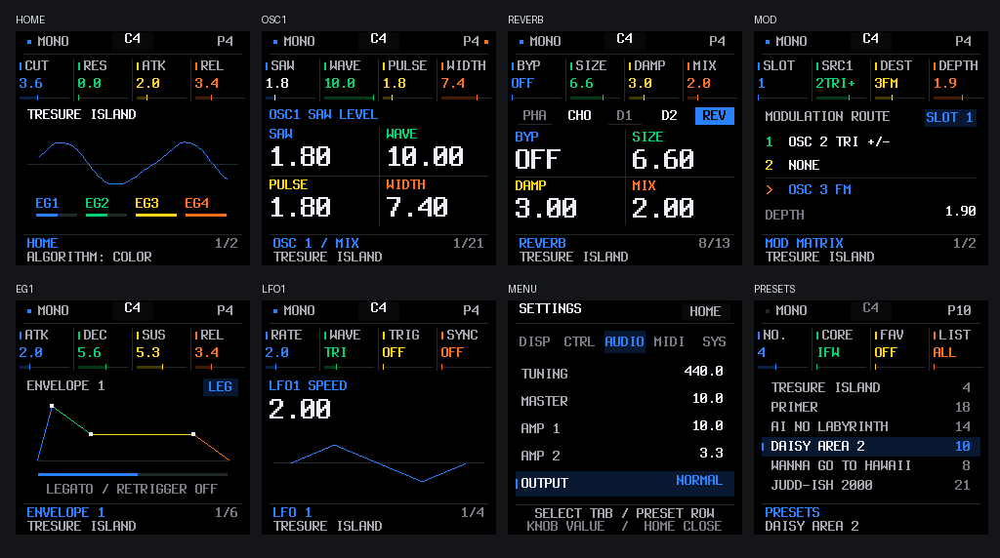
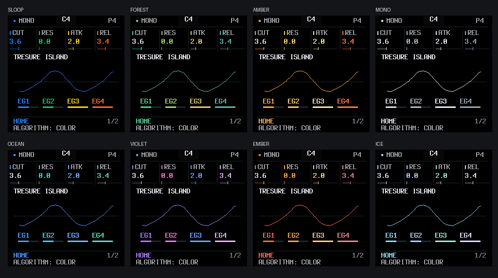

# 0.4.7-rc12：恢复原输出，固定主题背景

用户反馈 rc9 新增的效果器后驱动、立体声联动限幅和软削波过响、有失真感。本版恢复 **rc8 NORMAL 的音量和波形**，保留 rc11 的 SLOOP 界面、Terminus Bold 字体、8 套配色和旋钮分工。

- 输出从 rc9 LOUD 的 ×4 驱动恢复到原来的 ×2 标定；保留此前已采用的约 +6 dB 校准。
- 正式固件和 Web Demo 编译时关闭输出动态处理，限幅器包络、增益表、软削波以及模式渐变不参与运行。历史实现仅供显式启用的回归测试使用。
- 启动时把已保存的 LOUD 配置恢复为 NORMAL；AUDIO → OUTPUT 只读，不能意外重新开启。迁移不在启动或旋钮转动时写 Flash，不改音色、其他偏好及其 CRC 存储布局。
- 八套配色只改变强调色；页面背景固定 RGB565 `0x0000`，中性卡片底色同样固定。选中项仍使用主题色表示选中状态。
- OSC / FM、调制、包络、Mono / Legato、出厂预设、Q23 混响、CPU 优化、音频队列和 LCD 局部刷新调度保持原样。

[安装 0.4.7-rc12](https://rcell233.github.io/OpenIFW-fm1/install/?candidate=0.4.7-rc12&v=0.4.7-rc12) · [在线 Demo](https://rcell233.github.io/OpenIFW-fm1/?v=0.4.7-rc12)





## 验证方法

独立检出 rc8 提交 `911d90091cb36c8dba2628f5aca8bb2022609ead`，使用 WASI SDK 34 编译未修改的原版应用，得到 SHA-256 `7a21e3503fb178098354e873c5c26b128fbd7ba513da07add2215c39cd04b252`。这份原版建立了新的只读音频基准；没有用候选固件生成自己的预期值。

`tests/output_restore.mjs` 在六个原厂音色、MASTER 0 / 512 / 1023 下运行密集音符、延音踏板、弯音和释放尾音：**5,529,600 个声道样本完全一致，140,400 项演奏 / 包络 / 音色状态一致**。冻结基准在 [output-rc8-audio.json](evidence/output-rc8-audio.json)。旧 rc9 LOUD 音频基准继续对历史测试构建运行，没有覆盖原 fixture。

其他检查覆盖保存的 LOUD / NORMAL、旧版及坏 CRC 配置迁移；所有八套主题的保存与旧 rc10 兼容性；八主题 × 57 页面像素一致性、固定背景和连续转动时的刷新；安装完整镜像、恢复传输和旧 rc11 原包回退。`make test`、`make sanitize` 与新包的 pi32v2 启动 / 演奏模型记录汇总在 [验证证据](evidence/output-restore-0.4.7-rc12.json)。截图直接来自共享 C 固件的 LCD 像素。

## 固件资源

| 项目 | rc11 | rc12 |
|---|---:|---:|
| 应用镜像 | 258,776 B | 256,528 B |
| data + bss | 85,200 B | 84,160 B |
| RAM code | 21,884 B | 21,364 B |
| pool | 285,208 B | 285,208 B |

固件身份 `FM-1_982`，诊断版本 `40712`，包 SHA-256：

```
58336cb035e2686acce5e6df4ab0ba655bf4abc2bda5ec47a0a945c810bee7c4
```

这次恢复原输出不会消除原音色自身可能存在的饱和。没有连接硬件，软件逐样本一致性及指令模型结果不代表实机听感、CPU 占用或刷写验收。
