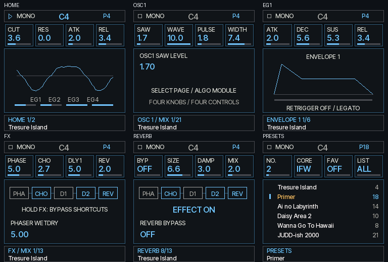

# 0.4.7-rc1：FM-1 实现调研、音频调度与清晰界面

**后续实机反馈：0.4.7-rc1 安装后进入 USB RESCUE（FM-1_000），正常固件没有启动。该版本已撤出默认安装，当前安装器恢复提供原始 0.4.6-rc2。下文的模型启动通过未覆盖这一实机故障，不能作为启动验收。**

0.4.6-rc2 的最新实机反馈是 UI 已流畅，爆音仍在。因此，上一版模型中没有 XRUN 并不能证明设备正常。本轮克隆了九个相关仓库和 Felucca 的引擎子模块，阅读 DSP、输入扫描、USB、音频中断与显示代码，并编译了 OberVave 作背景对照。

**四个振荡器本身不足以解释当前开销。OpenIFW 的通用矩阵、两倍内部采样、滤波与效果器实现，以及音频和高优先级服务的调度，都需要分别考察。0.4.7-rc1 已完成下述修改和软件验证，尚未通过实机声音验收。**

[安装候选版](https://rcell233.github.io/OpenIFW-fm1/install/?v=0.4.7-rc1) · [采集设备性能](https://rcell233.github.io/OpenIFW-fm1/diagnostics/) · [回退 0.4.6-rc2](https://rcell233.github.io/OpenIFW-fm1/install/?recovery=0.4.6-rc2&v=0.4.7-rc1) · [原始证据](evidence/research-0.4.7-rc1.json)

## 实际阅读的实现

完整提交号与克隆地址见 [锁定记录](evidence/fm1-references-2026-10-22.json)。下面的源码链接固定到本次研究的提交。

| 实现 | 源码与发现 | 对本项目的意义 |
| --- | --- | --- |
| Felucca | [audio.c](https://github.com/hugelton/Felucca/blob/63f88ec18b71c6ed4371d03d6f04dd93f4193ad3/firmware/src/audio.c)、[main.c](https://github.com/hugelton/Felucca/blob/63f88ec18b71c6ed4371d03d6f04dd93f4193ad3/firmware/src/main.c)：在 ALNK 中断合成；渲染期间 TIMER5 延后完整 USB 轮询，保留扫描和 UAC；全局共享效果器 | 音频应能抢占前台绘图，USB 工作必须区分紧急供数和完整轮询 |
| SLOOP、DXsloop | [SLOOP](https://github.com/isod89/sloop-fm1/tree/ec9e53721cc576816a5750220391f2d0217c01cb)、[DX kernel](https://github.com/zvenson/dxsloop/blob/eeec0a6c1c7f9a93865983a8c7f7cc42102e7472/firmware/src/dx7_core.c)：中断音频；DX 使用 Q24 查表、32 采样块和增益斜坡 | 六个 FM 算子不等于六条完整 VA 振荡器、任意矩阵、两倍采样和独立复杂滤波链 |
| OberVave | [obv_engine.h](https://github.com/zvenson/obervave/blob/7e1ccf9ca9e96a14a961e48ea8fe6efa907422df/firmware/src/obv_engine.h)：8 声部、每声部双 OSC；Q15 音频、Q13 SVF 系数，32 帧控制块和插值，全局 FX | 更窄且有明确范围的运算、把系数计算移出逐采样循环，确实更轻；直接换成其内核会改变现有声音 |
| Felucca-Engines | [eng_analog.c](https://github.com/hugelton/Felucca-Engines/blob/c46e0086f69bdc26df1cd144dca9e683cc4531dd/src/eng_analog.c)：Q15 / Q13 热运算与块级系数 | 可以借鉴计算组织；不能直接降低本项目精度、控制更新率来冒充等价优化 |
| X0X | [build.py](https://github.com/charlesvestal/fm1-x0x/blob/54194c54bb01e9d9b3fe9d641b3ddfa512ac04a3/tools/build.py)：显式启用 r3 单精度 FPU，关闭浮点收缩 | “芯片没有 FPU”不能作为全定点的理由；是否更快必须看生成指令。本版没有切换浮点引擎 |
| 官方 fm1_open | [board/audio.c](https://github.com/m-vave/fm1_open/blob/4c7496daac04a95ff10d1afdcc8f9ead2dbabc41/app/board/audio.c)：先渲染私有完整块，核对 DMA 半区归属和剩余时间后提交 | 借鉴完整块提交；其合成引擎来自 SDK 二进制，不能声称审查了全部 DSP 源码 |
| Ghoulbox、Dinghy | [Ghoulbox](https://github.com/jasonpersinger/ghoulbox-fm1-dungeon-synth/tree/f23fbc593f8af29dfa01174278f08ee79155ed27)、[Dinghy](https://github.com/zvenson/dinghy/tree/d44df7db09b98ccad2f1233b8f83f5f09c04829e)：面板操作、HAL、USB 和升级协议 | 保留用户已经认可的按钮与四旋钮映射，简化视觉；保持 loader 和存储格式兼容 |
| felucca-bsp | [BSP](https://github.com/hugelton/felucca-bsp/tree/33cac693903e753e8783baeed05c19cadfb04812)：时钟、RAM 段和中断支持 | 时钟与外设耦合，本版不提频；第二核也不作为未经实机验证的修复 |

这些项目并非无条件免于过载。Felucca 自身含接近预算时的声部淡出/减载逻辑；OberVave 的可选混响降频开关默认值是全速，不能把可选优化当作默认行为。多轨往往共享 FX，轨道数也不等于同时运行的最重声部数。

## 负载证据与边界

对 rc2 的第一个工厂音色执行 PC 计数：DSP 内共执行 394,189,722 条指令，其中 FX 与 EQ 合计 178,073,188 条，约 **45.17%**；纯波形求值辅助函数 38,076,809 条，约 **9.66%**。这是该场景的指令占比，不是实机 CPU 时间占比；后者也没有包含振荡器相位、FM 和混音的全部成本。不能把“OSC 波形辅助函数约 10%”说成“全部 OSC 只占 10%”。

另用相同工具链编译未经修改的 OberVave，选 preset 28 NEON PAD，在同一模型中按下 1 / 8 个不同音符，并检查实际活动声部数。只统计活动声部数恰好符合要求的观察窗口：1 声部 53 个窗口、引擎块 P95 1.297 ms；8 声部 51 个窗口、P95 2.931 ms。这说明更轻的算法组织有实际价值。两套引擎和计时边界不同，这不是同音色速度排名，也不是 OberVave 实机长期稳定性的证明。

本项目最终普通包与 rc2 在同一模型、相同脚本下，256 帧 DSP P95 如下：

| 工厂音色 | rc2（ms） | 0.4.7-rc1（ms） |
| --- | ---: | ---: |
| Tresure Island | 4.077 | 4.006 |
| Primer | 3.238 | 3.169 |
| Ai no Labyrinth | 3.530 | 3.455 |
| Daisy Area 2 | 4.181 | 4.134 |
| Wanna Go To Hawaii | 3.549 | 3.480 |
| JUDD-ish 2000 | 3.257 | 3.147 |

这只有约 **1%–3% 的 DSP 改善**，包含调度及事件对齐差异，不能全部归因于算术优化。六个场景中的 XRUN / DMA / missed commit 均为零。旧版 IRQ 只复制音频，新版 IRQ 包含合成，不能直接比较两版 IRQ 耗时来评价快慢。

模型采用 240 MHz、普通指令 1 周期、除法 48 周期与 SPI 60 MHz 假设；不是周期精确模拟，没有 Flash/cache/bus 等待，也没有 USB 主机。RAM 扫描与 USB 调度改动在实机能省多少时间，当前模型无法回答。

**压力测试仍未达标**：8 槽 LFO×EG→FM、24 级 Filter3、全部五个 FX、高音组合，完整 IRQ P95 6.409 ms、峰值 6.462 ms，超过 5.805 ms；408 次回调全部错过提交，主循环也被持续占用。没有用跳过 DSP 或改变音色掩盖此失败。因此，本版不能保证任意编辑音色都满足实时预算，也不能凭工厂场景通过宣布爆音已修好。

## 本次修改

1. **回到常规音频中断调度。** 移除前台四槽 PCM 生产队列；ALNK 优先于 UI，先生成私有完整块，再在短临界区核对半区、待决事件及剩余时间后复制到 DMA。入口确认当前事件，渲染期间的新事件保持待决。若已迟到则计数并保留旧完整块，避免提交半成品；迟到仍会影响声音，不被当作成功。
2. **恢复渲染期间完整 USB 轮询的延后。** 前台合成时旧版 `in_audio` 没覆盖渲染，USB 可在热计算中插入。新版按 Felucca 的职责分配处理，USB Audio 每 32 帧供数，避免等整个 256 帧结束才给 1 ms USB 包供数。USB 供数耗时单独计量。
3. **10 kHz 扫描与 ISR 包装放入 RAM。** 使用正常链接段与原启动复制机制；输入管脚、扫描顺序、消抖和编码器逻辑不变。测试比较自有 HAL 与原 vendor 的规范化代码，并验证目标复制后的每个字和输入映射。没有改寄存器映射、提频或假设外围器件允许省略 GPIO 时序。
4. **保持声音的局部 DSP 优化。** 缓存 patch 固定的 Sync / 输出选择和 LoFi 噪声周期；只在下一个振荡器确实消费 Sync 时计算交点分数；展开固定滤波拓扑、biquad 和 phaser 小循环。相位、噪声、FM 顺序、矩阵频率、包络曲线、两倍内部采样、预设、单音与 Legato 不变。所有旧音频和状态黄金值保持原值。
5. **清晰、朴素的 UI。** 用 Inter Tight 抗锯齿字体、深色纯面板、单线边框和高对比文字替换石纹与装饰。保留 57 页和原操作逻辑。REFRESH NORMAL / LOW 分别限制动态刷新为最高 20 / 10 Hz，两者都继续显示波形；这不是实机 FPS 承诺。波形和 EG 小区域独立损伤重绘，LCD 忙时保存操作，音频中断可抢占绘制。
6. **只读设备性能采集。** 新增 USB-MIDI SysEx 快照协议与网页，读取实际板载 TIMER4、音频、扫描、USB、削波和绘图统计。网页没有改 patch、输出模式、写 Flash 或清零命令。十秒采集保留 20 份原始读数，可直接下载 JSON；不要求抄录小屏参数。

实际 C/WASM 帧缓冲，首页由真实按住的 C4 发声生成：

## 验证和安装包

- `make test`、`make sanitize`：参考引擎、定点、原生独立/合并编译、ASan/UBSan、57 页交互和显示通过。
- 166 场景的 332 份旧 PCM / 状态、12 组 0.3 冻结演奏哈希均不变；24,502,072 字节原生 C / WASM 输出一致。1,098 项出厂音色字段、192 项矩阵字段、120 项包络字段不变。
- 真实 ISR 功能模型：前台注入 40 ms 绘图，DSP 占周期 75% 时，旧 rc2 队列出现 174 次缺块，新路径为零；95% 负载仍完成提交。0.99–2.10 倍预算的迟到案例禁止写 DMA，保留后续事件，并正确计数。该测试验证调度语义，不测设备速度。
- 原生产 TIMER5、USB 重试、SIE 超时和 OTA / UBOOT / 诊断标签隔离通过；C 编码到 JS 解码的 uint32 边界与页面 20 份快照、计数重置和权限流程通过。
- 最终普通包在目标解释器正常启动、物理 OCT− 救援启动和 RAM 装载检查通过。自测变体运行实际 pi32v2 的 16 个冻结校验，数学错误为 0；IRQ 流变体的 196,608 帧、24 个校验值全部保持原值。自测/压力变体没有作为安装包发布。
- 安装器模拟设备的 105 项检查通过，包含完整传输、救援恢复、身份不符拒绝和原始回退包校验。实际 USB / Web MIDI、模拟器之外的浏览器交互和实体音频尚未验证。

普通包 `OpenIFW-FM1-0.4.7-rc1.fwsc`：610,161 B；SHA-256 `eee0eb4f134389919779fcea5c2779d35f938359df3e297fb48b0810a68e0f8f`。app 270,716 B，data+bss 75,600 / 98,304 B，pool 324,936 / 344,064 B，RAM code 22,552 / 24,576 B。相对 rc2 的 data+bss 减少 6,272 B。固件身份仍是 FM-1_982，救援身份 FM-1_000 不能算安装成功。

安装后如仍破音，在[设备性能页](https://rcell233.github.io/OpenIFW-fm1/diagnostics/)连接对应 MIDI 输入/输出，开始十秒采集，同时演奏出问题的音色、转动旋钮和切页。先看 XRUN / DMA / missed commit 是否增长，再结合 CLIP、USB Audio 和完整 IRQ 峰值判断是超时、削波还是输出链路问题。计数为零也不单独构成声音验收，原始 JSON 与实际听感须一起判断。
