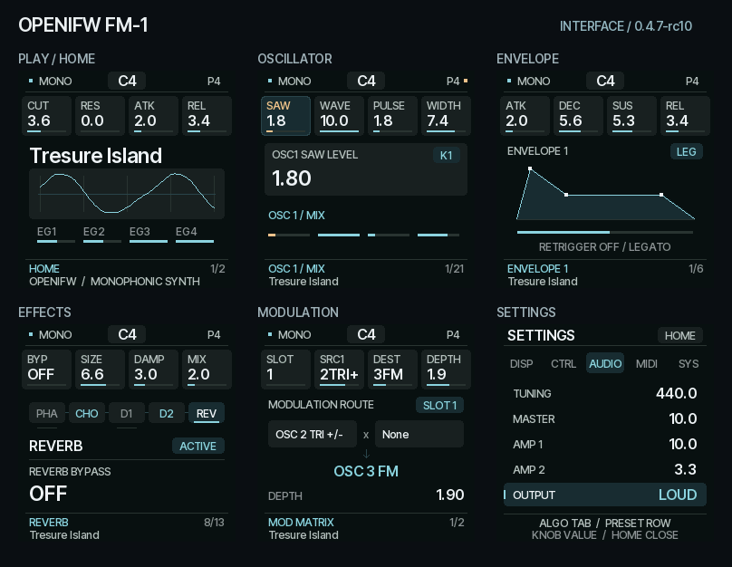
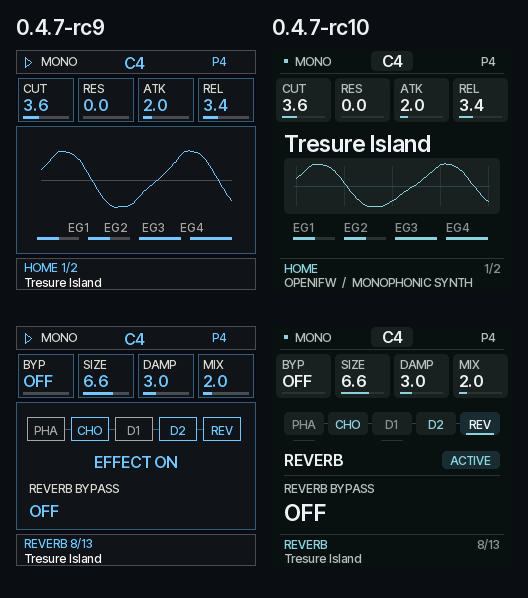

# 0.4.7-rc10：界面更新

2026-11-01。固件身份 `FM-1_982`，诊断版本 `40710`；实机待验收。

[网页体验](https://rcell233.github.io/OpenIFW-fm1/) · [安装 rc10](https://rcell233.github.io/OpenIFW-fm1/install/?candidate=0.4.7-rc10&v=0.4.7-rc10) · [恢复 rc9 界面](https://rcell233.github.io/OpenIFW-fm1/install/?recovery=0.4.7-rc9&v=0.4.7-rc10)



## 设计与操作

这次整理的是 240×240 LCD 中的信息层级。炭黑底色、低饱和蓝色强调、浅色数值，让页面标题、参数值、选中项和辅助说明容易区分。四个旋钮仍与屏幕上方四张卡片直接对应；选中的卡片同时显示边缘、颜色和 K1–K4 标记。首页突出音色名，并保留实时波形和四个包络指示。

包络页保留真实参数曲线及 Legato / Retrigger 状态；效果器页区分当前模块、ACTIVE/BYPASS 状态和正在编辑的参数；矩阵页明确显示两个来源与目标；设置页以填充选中行取代大量同权重细框。SAVE、命名、确认弹窗与列表同步整理。BLUE / GREEN / AMBER / MONO 和 FILLED / OUTLINE 偏好仍可用。

57 页、按键与旋钮映射、长按和双击、预设选择、保存及撤销逻辑不变。没有新增动画、纹理、阴影、字体资源或全屏缓存。圆角使用固定矩形组合。文字使用已有 Inter Tight 位图，以当前平面底色构建抗锯齿调色表，消除深色卡片上的黑边；不会在每个像素上做 alpha 混合。



视觉组织参考 [Felucca](https://github.com/hugelton/Felucca/tree/406b328ee43ffb8fd3d2eb4cce1a741db4a4cea1) 和 [Melodee](https://github.com/keremimo/melodee/tree/c14912ba911d4f4fefaa07120eb068a91d7ccb78) 的模块分组与克制的选中强调。截图来自本项目真实 C/WASM 渲染，不是概念图。未引入其他项目的合成器、预设或图像资产，归属见 THIRD_PARTY_NOTICES。

## 性能与声音

显示调度函数与 rc9 字节一致：仍是六个局部矩形、原刷新节奏和音频优先调度。移除重复的内容底色填充；LFO 预览复用前一个端点，波形计算次数从 358 次降至 180 次；包络填充斜率每个线段算一次。

以下为相同脚本、Daisy 预设下的 pi32v2 **指令模型**对照：切换 OSC / ENV / LFO / FX / HOME / MENU、转动旋钮并演奏。使用相同模拟器、240 MHz 设置、除法 48 周期假设与 SPI 线速模型；不模拟真实缓存、Flash、总线或 USB 主机，不能视为实机时间或帧率。

| 测量项 | rc9 | rc10 |
|---|---:|---:|
| 标题区域最大绘制时间 | 300 µs | 225 µs |
| 四参数区域最大绘制时间 | 604 µs | 597 µs |
| 内容区域最大绘制时间 | 1,395 µs | 1,010 µs |
| 页脚区域最大绘制时间 | 551 µs | 480 µs |
| 实时波形区域最大绘制时间 | 473 µs | 510 µs |
| 包络指示区域最大绘制时间 | 42 µs | 32 µs |
| 7.5 秒内传输 LCD 像素数 | 1,611,120 | 1,611,120 |
| 输入服务最大间隔 | 2 ms | 2 ms |
| 音频欠载 / IRQ 超时 / DMA 迟到 | 0 / 0 / 0 | 0 / 0 / 0 |
| DSP 块中位时间 | 2,881 µs | 2,881 µs |

内容区域最慢一次绘制约降低 27.6%，波形区域增加约 37 µs；不宣称所有区域都变快。显示区域更新次数分别为 24 / 17 / 15 / 10 / 42 / 11，两版完全相同。主机绘制测试作为辅助证据保存，不能换算设备 FPS。

生产构建 data+bss 为 **85,168 / 98,304 B**，比 rc9 增加 **320 B**，用于缓存字体前景／背景颜色组合。pool 保持 285,208 / 344,064 B，RAM code 保持 21,884 / 24,576 B；app 从 274,520 增至 275,432 B。HAL、DMA、链接布局、DSP 热代码和显示缓冲区未改。

`tests/ui_visual_freeze.py` 检查 33 个音频、控制、平台与字体文件的 rc9 哈希，以及忽略诊断版本号的 app 桥接文件和完整显示调度函数。`tests/ui_rc9_audio.mjs` 使用已发布 rc9 WASM（SHA-256 `accc8ae24fc6b3b99ef7187829a3c6d9e9c5d3bcfd37229de51c52e6734b7428`）建立不可由当前引擎重录的基线：六个原始程序、两个 MASTER 设置、密集演奏、参数编辑和切页，共 **3,686,400 个声道采样、108,000 次演奏／控制状态检查一致**。原始音色、OSC / FM、调制、包络、Mono / Legato、Q23 混响和 rc9 的 LOUD / NORMAL 输出处理不变。

## 验证与复现

完整结果见 [机器可读证据](evidence/ui-0.4.7-rc10.json)。测试包括：

- `make test`：独立像素对照、57 页局部／同步渲染一致性、连续旋钮、按键和存储、音频回归、ASan/UBSan、安装协议。
- `make sanitize`：桌面参考引擎的 ASan/UBSan 对照。
- 杰理生产构建、内存和分区检查、包 SHA-256 / CRC；相同工具链重复构建。
- 真实 rc10 包在指令解释器中正常启动运行超过 32 秒并清除 pending guard；OCT− 开机进入 USB RESCUE 路径。

```sh
make test
make sanitize
node tools/capture_ui_refresh.mjs
# 目标环境按 README 准备；生成 elf 对应的符号表后运行：
IFW_SIM_BOOT_MS=32000 IFW_SIM_WALL_MS=1500000 node tests/target_boot.mjs \
  /path/to/fm1_web.wasm firmware-bin/OpenIFW-FM1-0.4.7-rc10.fwsc \
  /path/to/rc10-symbols.json build/ui-refresh/boot.json
```

目标测试的完整脚本、模拟器哈希、包哈希、各区域耗时及零欠载记录保存在证据中。未连接实体 FM-1，也未声称实测帧率、USB 刷写或实机音频已通过。本轮可用 rc9 回退包恢复旧外观，音频实现相同。
