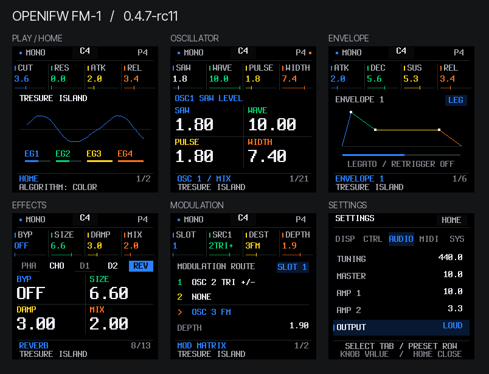
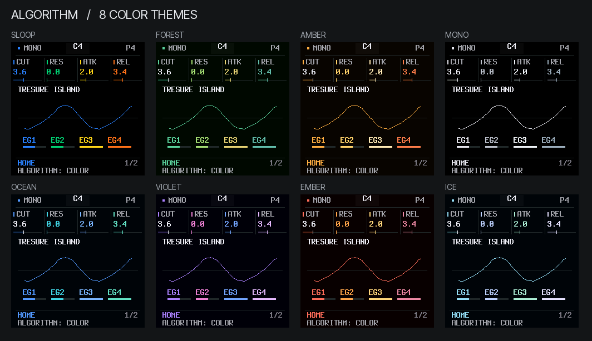

# 0.4.7-rc11：SLOOP 风格、像素字体与配色旋钮

2026-11-01。固件身份 `FM-1_982`，诊断版本 `40711`；实机待验收。

[在线体验](https://rcell233.github.io/OpenIFW-fm1/?v=0.4.7-rc11) · [USB 安装](https://rcell233.github.io/OpenIFW-fm1/install/?candidate=0.4.7-rc11&v=0.4.7-rc11) · [回退 rc10](https://rcell233.github.io/OpenIFW-fm1/install/?recovery=0.4.7-rc10&v=0.4.7-rc11)



## 字体与界面

参考 SLOOP `91f30182d9095e0ecdb43396554f2ce5a67df179`。其固件的 `tools/gen_font.py` 使用 **Terminus Bold 8×16**，大字为整数 2 倍的 **16×32**，以大写显示；普通 Terminus 还用于网页编辑器。这次采用同一份未修改的 `ter-u16b.bdf`，许可为 SIL OFL 1.1，完整版权与许可随源码保留。

字体转换为已有画布支持的位图格式，保留源字形的整数像素；无 TTF 运行时、抗锯齿缩放或新绘图库。界面独立实现 SLOOP 的黑底、细分隔线、四参数分色和大号数值：顶部四列直接对应四个参数旋钮，普通编辑页以四格大数值呈现，包络、LFO、效果器和矩阵保留各自的图形与状态。首页仍显示真实波形和四个 EG 指示；没有增加轨道、音序器或 SLOOP 的合成引擎。

## 旋钮分工

rc10 的 SELECT 与 ALGORITHM **不是完全相同**：前者翻当前组的子页，后者跳模块，并兼任菜单分类或命名光标。按本次要求，ALGORITHM 现在是专用配色旋钮。

| 控件／场景 | rc11 行为 |
|---|---|
| ALGORITHM，所有页面 | 顺／逆时针循环切换 8 套配色；菜单、快捷层、命名和确认窗口中也只改变配色 |
| SELECT，普通页面 | 当前组前／后一页；按原规则浏览音色列表、用户槽和全部参数页 |
| SELECT，HOME 菜单 | 选分类：DISP / CTRL / AUDIO / MIDI / SYS |
| PRESETS，HOME 菜单 | 选行；参数旋钮或 OCT± 改值 |
| SELECT，命名窗口 | 移动光标；第二参数旋钮也保留此功能 |
| PRESETS，命名窗口 | 改字母；第一参数旋钮和琴键输入也保留 |
| SELECT，矩阵快捷层 | 选调制槽；普通矩阵页仍用 SLOT 参数旋钮选择 |

原来的 57 页与四参数映射保留。模块均可通过页面按钮／SELECT 到达，EDIT 快捷层仍可直达 OSC / Filter。换配色不会加载音色、改参数、换页、确认或取消弹窗，也不会触发 Flash 写入。



配色：**SLOOP、FOREST、AMBER、MONO、OCEAN、VIOLET、EMBER、ICE**。它们是小型 RGB565 配色表，同一组颜色对应文字、参数值、进度指示与图形，不是每帧逐像素执行颜色滤镜。

保存开机配色：长按 HOME → SELECT 选 SYS → PRESETS 选 SAVE SETUP → 旋钮 1 右转 → OCT+ 确认。沿用静音与事件队列检查后写入的机制，不在每个配色刻度写 Flash。偏好记录仍为 60 字节、原地址与 CRC：基础 palette 字段保持 0–3，扩展主题保存到原末尾预留字节，并带标记。这样回退 rc10 仍能读到 LOUD / NORMAL、用户名称等其他设置；新增主题回退为其兼容基础配色。若旧版更改基础配色，新版只在扩展标记与基础配色一致时恢复扩展主题。

## 性能

显示仍使用同样六个局部矩形、动态刷新节奏、音频优先级和 DMA busy gate。唯一的调度调整是：**连续配色变化沿用当前绘制游标**；页面／窗口布局改变仍从顶部开始。这样快速转 ALGORITHM 时，下面的区域不会因为每个刻度都重置游标而饿死。无需新增帧缓冲。

对照使用相同 Daisy 预设、音符、参数编辑和 SELECT 切页脚本，运行 7.5 秒。以下是实际 `.fwsc` 在 pi32v2 指令解释器中的结果，**不是实机测量**；采用 240 MHz 设置、除法 48 周期假设与 SPI 线速模型，不模拟真实缓存、Flash、总线或 USB 主机。

| 区域最大绘制时间 | rc10 | rc11 |
|---|---:|---:|
| 标题 | 178 µs | 151 µs |
| 四参数列 | 597 µs | 385 µs |
| 页面内容 | 1,010 µs | 977 µs |
| 页脚 | 368 µs | 281 µs |
| 首页波形 | 520 µs | 410 µs |
| EG 指示条 | 31 µs | 31 µs |

同一脚本下，更新次数均为 20 / 16 / 12 / 7 / 59 / 12，总传输均为 **1,743,840 LCD 像素**。音频 DSP 块中位耗时均约 3,019 µs，输入服务最大间隔均为 2 ms，UND / IRQ 超时 / DMA 迟到均为 0。额外的快速配色脚本在 3 秒内安排 100 个正反向旋钮输入，四个主要区域均继续更新，输入服务最大间隔为 2 ms，同样未记录音频欠载。模拟器会合并输入与显示工作；这不是每秒完整刷新次数或硬件 FPS 的声明。

| 资源 | rc10 | rc11 |
|---|---:|---:|
| 应用程序 | 275,432 B | 258,776 B |
| data + bss | 85,168 B | 85,200 B |
| pool | 285,208 B | 285,208 B |
| RAM code | 21,884 B | 21,884 B |

程序减少 **16,656 B**，RAM 增加 **32 B**；目标分区、音频内存、DMA 和链接脚本不变。

## 验证

[机器可读证据](evidence/ui-0.4.7-rc11.json) 包含固件哈希、模型脚本、资源、逐采样测试与启动结果。

- `tests/ui_themes.mjs`：六个音色密集演奏／切页／改参数时连续转配色旋钮，**2,457,600 个声道采样与不转配色的实例完全一致**；所有 8 套配色保存、CRC 重启恢复、命名与确认隔离通过。
- `tests/ui_rc9_audio.mjs`：原冻结基线保持不动，**3,686,400 个声道采样、108,000 项控制／演奏状态**与发布 rc9 一致。
- `tests/panel_test.c`：**57 页 × 8 配色**的同步／局部绘制像素一致，连续参数和配色操作都能推进所有区域；8,320 次独立像素对照及 ASan/UBSan 通过。
- 1,170 项原交互检查、完整安装器传输／回退测试、`make test`、`make sanitize` 通过；69 份上游文件校验通过。
- `tests/ui_visual_freeze.py`：30 个音频／平台／页面映射文件仍为 rc9 原哈希；只允许本次字体、UI 状态与导航文件变化，以及启动提示文字和配色刷新游标的具体替换。合成、预设、单音／Legato、包络、调制、Q23 混响、LOUD / NORMAL 输出均未更改。
- `tests/ui_theme_rc10.mjs` 用已发布 rc10 的原始 WASM 验证全部 8 套设置的向后兼容，NORMAL 输出与音色均保留。
- 杰理工具链生产构建及重复构建一致；目标解释器正常启动运行超过 32 秒后清除启动保护标记，OCT− 开机救援入口通过。

未连接实体 FM-1，实机帧率、USB 安装和实机声音仍待验收。在线 Demo 与设备使用同一 C 绘制和交互代码。

```sh
make test
make sanitize
python3 tools/generate_ui_font.py --check
node tools/capture_ui_refresh.mjs build/web/openifw.wasm build/sloop-ui/screens
```

SLOOP 源码：[isod89/sloop-fm1](https://github.com/isod89/sloop-fm1/tree/91f30182d9095e0ecdb43396554f2ce5a67df179)。字体和设计参考归属详见 THIRD_PARTY_NOTICES；本仓库没有引入它的图像素材、标志或预设。
