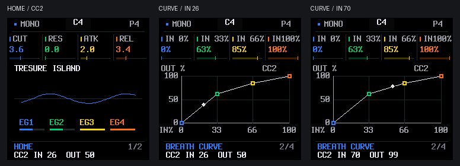

# OpenIFW 1.3.1 → FM-1 rc14：哪些改动影响演奏？

FM-1 rc13 原来锁定的是 2026-10-18 的 [OpenIFW 1.3.0](https://github.com/rcell233/OpenIFW/commit/a478abd0645225add3f2a7751522da1bced7a2e6)。到 11-01 的 [1.3.1](https://github.com/rcell233/OpenIFW/commit/e8339dab2cee475b9884effbc9c6c906e5b96099) 之间只有这一笔提交。[上游完整差异](https://github.com/rcell233/OpenIFW/compare/a478abd0645225add3f2a7751522da1bced7a2e6...e8339dab2cee475b9884effbc9c6c906e5b96099) 涉及说明、版本号、DSP 核心和新增音符交接测试四个文件。已将原版 JS 核心和来源哈希更新，并把行为分别移植到桌面浮点参考与 FM-1 的定点 C 引擎；网页运行后者。

| 演奏条件 | rc13 | rc14 |
|---|---|---|
| 同一渲染时刻先松最后一个旧音、马上按新音 | 先进入释放，再把新音当作断奏；与反过来发消息的波形可能不同 | 两事件间没渲染采样，按连音处理。四个 EG 分别服从音色自己的 Retrigger |
| 松开最后一个音后真正走过至少一个采样 | 释放，下一音重新起音 | 保留。处理长度为 0 不算经过一个采样；Panic 清除待处理释放 |
| 收到不在按键栈中的 Note Off | 可能重新设置滑音起点与计时 | 忽略，当前音高和滑音进度都保留 |
| 一个音持续按住、没有换音 | 连续渲染 | 未改此路径的计算。振荡器、矩阵、LFO、效果、六个预设和 NORMAL 输出参数未改 |

目标板沿用 44.1 kHz、每 256 帧接收一批音频事件的调度。这里的“同一时刻”指两个事件之间没有生成合成采样，不代表增加了 USB MIDI 的逐采样时间戳。PERF 的 SINE/MUTE 虽然暂时绕过合成器，但输出时钟仍在走，必须在诊断输出开始时提交待处理释放，避免回到 SYNTH 后多出一次连音。

## 旧版与新版的定点 PCM 实测

用同一份 [原生测试](../tests/note_handoff.c) 分别编译 rc13、rc14 的生产 DSP。每个音色吹住 C4 约 2 秒，在 88199、88200、88201 三个采样位置分别换成 G4。比较“先 Off 再 On”与“先 On 再 Off”之后的左右声道，各取 8192 帧。表中是**数值不一致的声道采样数**，每行共 49152 个；不是爆音个数或可听响度。

| 出厂音色 | rc13 不同 | rc14 不同 | 换音前连续 2 秒 PCM 校验值（两版相同） |
|---|---:|---:|---|
| Tresure Island | 49087 | 0 | 44bd53d0 |
| Primer | 49021 | 0 | a61359f5 |
| Ai no Labyrinth | 48924 | 0 | 4b35d095 |
| Daisy Area 2 | 0 | 0 | 01758af8 |
| Wanna Go To Hawaii | 45806 | 0 | 3693e3df |
| JUDD-ish 2000 | 48819 | 0 | 54ad494b |

上游自带 11 项测试全过。固件测试另覆盖四个 EG 各自开/关 Retrigger、零长度渲染、一个采样的真实间隔、未知 Note Off、Panic 和按键优先级。[WASM 端到端测试](../tests/midi_handoff.mjs) 从 MIDI 入口驱动六个预设，直接松音、通过延音踏板松音，两种消息顺序均得到完全相同的左右声道 PCM。原 rc8 NORMAL 输出、历史 LOUD 模式的既有 PCM 与状态基线保留，没有重新录制。

## 显示与实机验收范围

图中四点输出为 0/63/85/100%。输入从 26 增到 70 时，映射输出由 50 变成 99。画面读取 MIDI 路由已接受的原始值，并调用发给 DSP 的同一映射函数；不把滤波后的包络当作呼吸输入。色块是编辑锚点，菱形是演奏位置。没有收到输入时不画点；实际收到 0 则显示零输入位置。输入不变时拧旋钮也会更新输出与光点。

只在 HOME 或曲线页更新读数。CC 变化更新 240×16 底行；曲线光点移动更新不超过 512 像素的小矩形，远距离跳转分两次更新 9×9。沿用音频优先、DMA 空闲才绘制的调度；测试将逐次局部刷新与完整 LCD 逐像素比较，并模拟 DMA 忙、音频缓冲不足和 CC 突发。旋钮改变折线形状时才需要重画图表本身。

固件使用杰理目标工具链编译。以上是软件验证，没有测量这台设备的 DAC、硬件 CPU 或欠载次数。这次能确定修复的是换音顺序引起的波形差异；若吹住同一个音、不换指仍会爆音，应单独采集 PERF 的 OVERRUN/CLIP 和音频，不能用本次结果解释。
